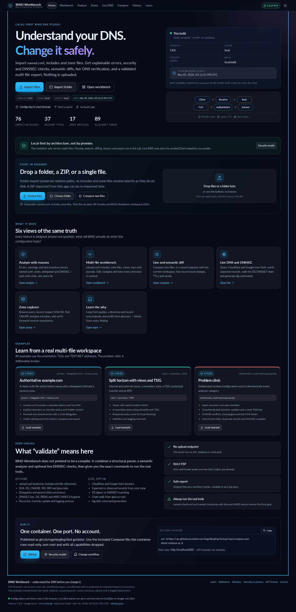
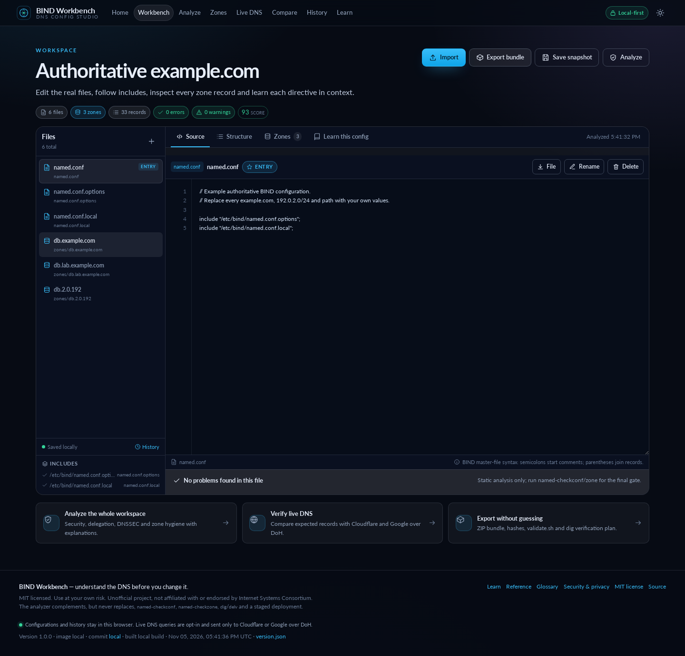
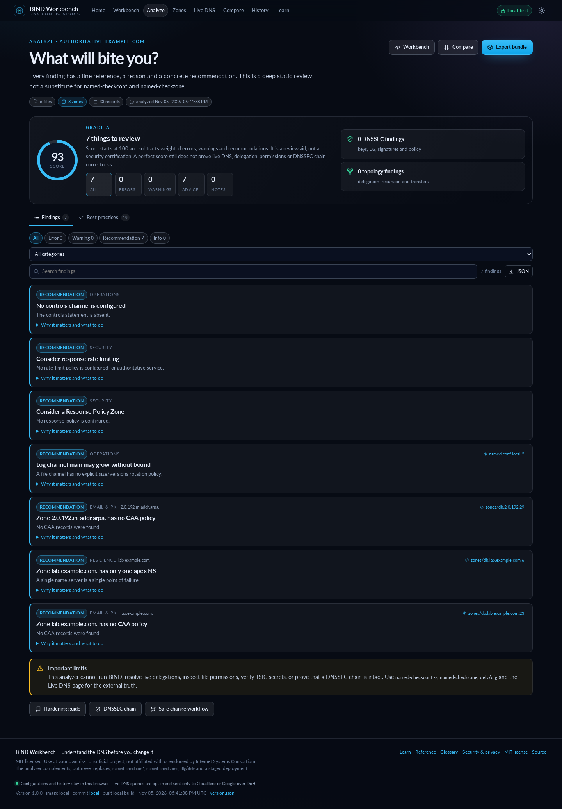
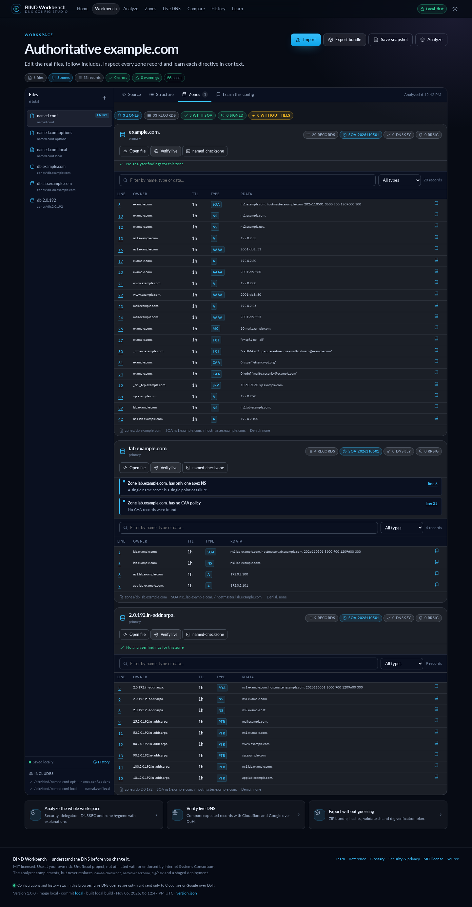
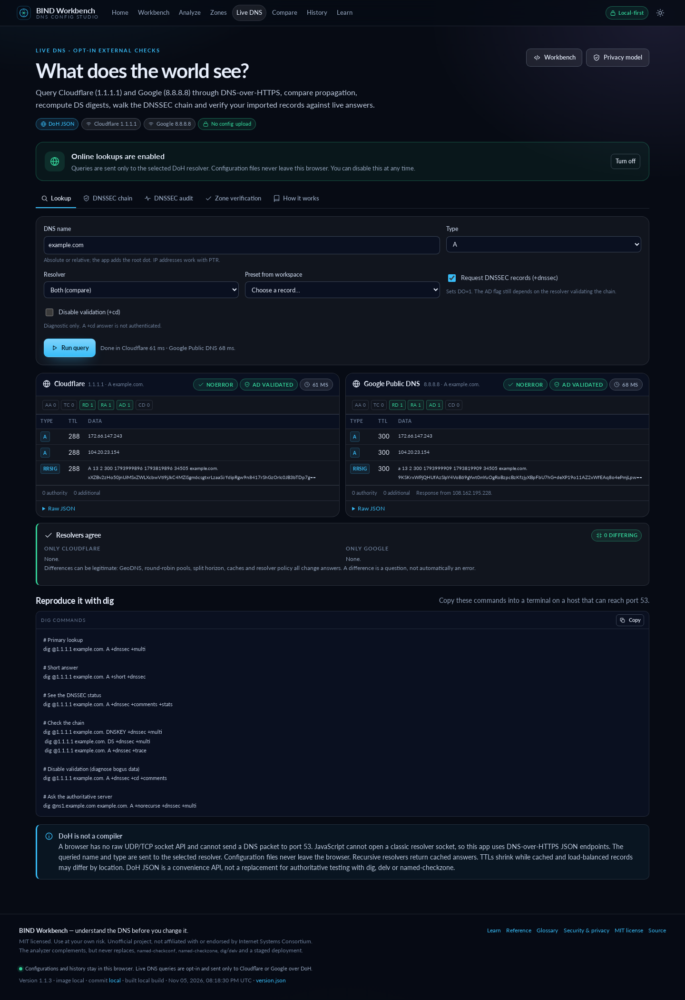
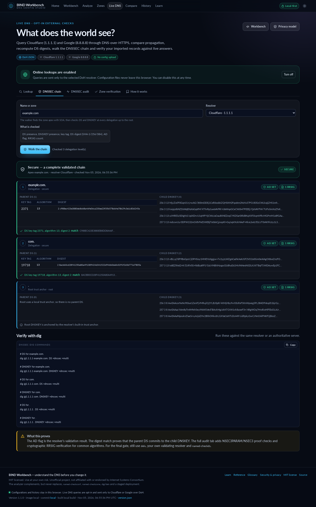
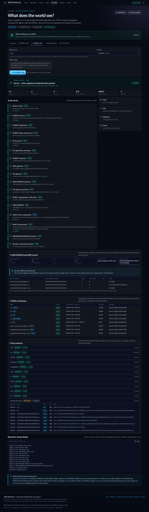
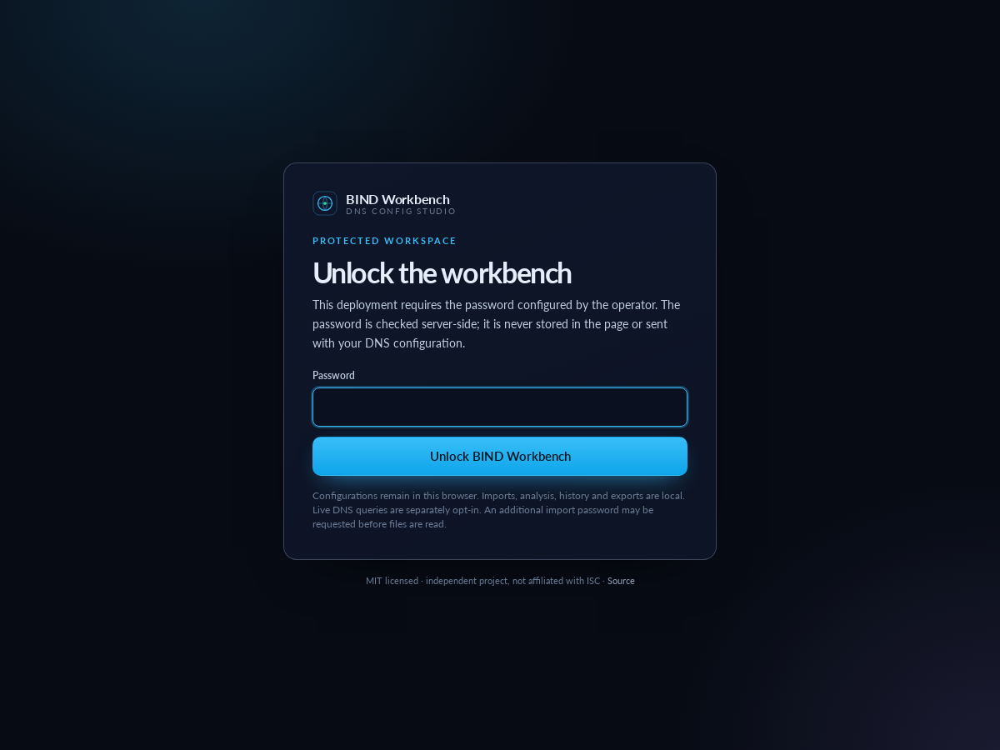
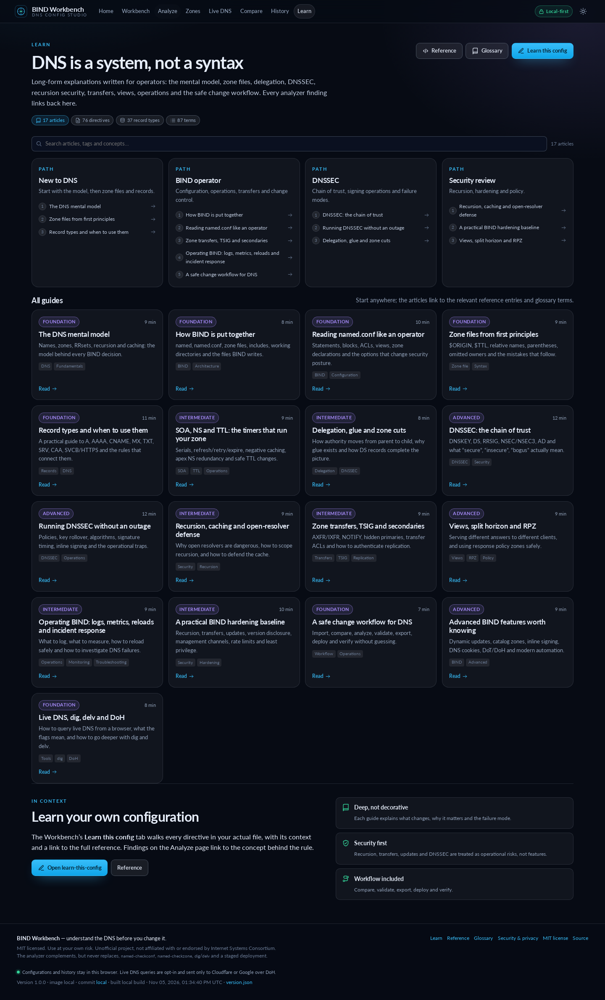

# BIND Workbench

**A local-first BIND DNS configuration studio: import, explain, analyze, compare, validate, verify and safely export `named.conf` and zone files — without uploading the configuration anywhere.**

[](https://github.com/RogerBergling/bind-gui/actions/workflows/ci.yml)
[](https://github.com/RogerBergling/bind-gui/actions/workflows/docker-publish.yml)

```
Import → parse → explain → analyze → compare → edit → export
                                      ↕
                          100-version local history
                                      ↕
                    opt-in Live DNS / DNSSEC checks (DoH)
```

The published container is a static file server with optional password-session endpoints. Parsing, analysis, record inspection, diffing, DNSSEC digest checks, history and export all run in your browser. There is no account system, database, config upload endpoint, analytics script or third-party request — except the opt-in Live DNS queries you explicitly send to Cloudflare or Google. Configuration data never leaves the tab.

> **MIT licensed. Use at your own risk.** This is an independent tool, not official BIND or ISC software. Generated exports are annotated source bundles, not a deployment system. Always review the change and validate with the exact BIND binary using `named-checkconf`, `named-checkzone`, `dig`/`delv` and a staged deployment.

---

## Quick start

**You only need Docker with Compose. No account, database, build step or host-side Python/Node installation.**

```sh
curl -O https://raw.githubusercontent.com/RogerBergling/bind-gui/main/compose.yaml
docker compose up -d
```

Open **http://localhost:8005**.

```sh
# Stop it
docker compose down

# Update later
docker compose pull
docker compose up -d --force-recreate
```

> **First pull/auth issue?** If GHCR says the package is private, make it public under **GitHub → Packages → bind-gui → Package settings → Change visibility → Public**, or run `docker login ghcr.io` first.

### Optional password protection

Imports are processed locally, so a password implemented only in JavaScript would be cosmetic. This deployment supports an optional **server-side password gate** that protects the whole app — including every import/upload, export and history surface — before any of the application assets are served.

Set a password in `.env` next to `compose.yaml`:

```sh
cp .env.example .env
python3 -c 'import secrets; print(secrets.token_urlsafe(32))'
# put the generated value in .env as BIND_WORKBENCH_PASSWORD=...
docker compose up -d --force-recreate
```

Or when running directly:

```sh
BIND_WORKBENCH_PASSWORD='a-long-random-value' python3 start.py
```

When the variable is set:

- `/` serves a login page instead of the workbench.
- Application scripts and JSON files return `401` until authenticated.
- The password is checked server-side with `hmac.compare_digest`; it is never embedded in HTML or JavaScript.
- A successful login creates a random, `HttpOnly`, `SameSite=Strict` session cookie. Sessions live in process memory and expire after 12 hours by default (`BIND_WORKBENCH_SESSION_HOURS`).
- Five failed attempts per IP within a minute trigger a temporary `429` throttle.
- The top bar shows a lock button when auth is enabled; it clears the session and returns to the login page.
- The password protects the whole app, not just a single upload route. Configurations still never leave the browser.

> **Use HTTPS whenever the password gate is reachable beyond localhost.** The password is submitted over HTTP and a reverse proxy should terminate TLS. Set `X-Forwarded-Proto: https` so the session cookie is marked `Secure`. For public or multi-user deployments, also use reverse-proxy authentication (Basic Auth, OIDC or an identity-aware proxy); this app-level password is a single shared secret, not a user system.

### First five minutes

1. Open **Home** and choose **Import files**, **Import folder**, or drop a folder/ZIP.
2. Open **Workbench** to inspect the file tree, includes, structure and source.
3. Open **Zones** to browse every record, SOA/NS and DNSSEC state.
4. Open **Analyze** for explainable errors, warnings, best practices and a pass/review/fail checklist.
5. Open **Compare** to compare two files, or a saved snapshot with the current workspace.
6. Enable **Live DNS** only when you want public DNS checks; then verify records or walk the DNSSEC chain.
7. Use **Export bundle** to download the multi-file ZIP with a manifest, `validate.sh`, `VALIDATE.md` and `VERIFY.md`.
8. Save snapshots from the Workbench; review, compare and restore them in **History**.

Everything except the explicit DoH queries runs locally in the browser.

---

## Screenshots

| Home | Workbench |
| --- | --- |
| [](docs/screenshots/home.png) | [](docs/screenshots/workbench.png) |

| Analyze | Zones |
| --- | --- |
| [](docs/screenshots/analyze.png) | [](docs/screenshots/zones.png) |

| Live DNS | DNSSEC chain |
| --- | --- |
| [](docs/screenshots/live.png) | [](docs/screenshots/dnssec.png) |

| DNSSEC audit (NSEC3PARAM + RRSIG) | Password gate |
| --- | --- |
| [](docs/screenshots/audit.png) | [](docs/screenshots/login.png) |

| Learn | |
| --- | --- |
| [](docs/screenshots/learn.png) | |

All screenshots use the included anonymised examples and the real UI. The live screenshots show public `example.com` answers from Cloudflare and Google.

---

## What it does

### Import: multi-file workspaces, not one blob

- Import individual files, a whole folder, a ZIP bundle or a BIND Workbench workspace JSON.
- Folder import preserves relative paths, so includes and zone files resolve the way they do on disk.
- The workspace keeps `named.conf`, includes, zone files, TSIG key declarations, views, ACLs and logging blocks together.
- Absolute paths such as `/etc/bind/named.conf.options` are resolved against the imported tree; unresolved files are reported, never silently guessed.
- New files can be added, renamed and deleted; one named-style file can be marked as the entry point.
- Unknown directives and record types are preserved exactly as written. The tool does not silently delete data it does not understand.

### Analyze: findings with a reason and a recommendation

Every finding carries a severity, category, exact file/line, what happened, why it matters and a concrete recommendation. Categories include:

- **Syntax and structure** — named.conf parse errors, unresolved includes, missing zone files, duplicate zones, missing entry points.
- **Recursion and exposure** — open recursion, open cache, missing recursion policy, listener defaults, management and statistics endpoints.
- **Transfers and updates** — unrestricted AXFR/IXFR, weak or missing authentication, address-only updates, missing journals, primary/secondary mistakes.
- **Zone hygiene** — SOA and apex NS, serial and timers, TTLs, CNAME rules, MX/SRV/NS targets, glue, duplicate and out-of-zone data.
- **Delegation** — parent/child NS consistency, in-bailiwick glue, DS ↔ DNSKEY matching for imported zones.
- **DNSSEC** — DNSKEY protocol/flags/algorithms/key size, DS digest types, RRSIG expiry, NSEC/NSEC3 consistency, high iteration counts, inline-signing and policy mistakes.
- **Operations** — logging, bounded channels, query logging, rndc controls, statistics, rate limiting and RPZ.
- **Mail and PKI hygiene** — CAA policy, obsolete SPF RR, DMARC visibility, null MX mixing and forward/reverse consistency.

The score is a review aid, not a certification. The **Best practices** tab is a pass/review/fail checklist, and every item links to the deeper explanation.

### Zones: every record in context

- Zone list with type, view, file, record count, SOA serial, DNSSEC keys/signatures and findings.
- Searchable record table with owner, TTL, class, type, canonical RDATA and an exact source-line link.
- SOA timer summary, apex NS list, DNSSEC inventory and denial-of-existence state.
- Copy-ready `named-checkzone` command and a direct link to live verification.
- Standalone zone files are parsed with an inferred origin; parent and child zones imported together enable cross-zone checks.

### Compare: line and semantic diffs

- Compare two independent files by picker, drag/drop, paste or loading a workspace file.
- Unified line diff with old/new line numbers and hunk counts.
- **Semantic zone diff** by owner, type and canonical RDATA: records added/removed, TTL changes and SOA serial changes.
- **Semantic named.conf diff** at directive level, ignoring comments and reordering.
- Compare any saved snapshot with the current workspace file by file.
- A serial that does not increase is called out because secondaries may ignore the change.

### Live DNS and DNSSEC: what the world actually sees

Live checks are **explicitly opt-in**. A browser cannot open UDP/TCP port 53, so the app uses DNS-over-HTTPS JSON from:

- **Cloudflare 1.1.1.1** — `https://cloudflare-dns.com/dns-query`
- **Google Public DNS 8.8.8.8** — `https://dns.google/resolve`

Capabilities:

- Query any common type, with `DO` (DNSSEC OK) and `CD` (checking disabled) controls.
- Query one resolver or both and compare propagation.
- Show RCODE, AA/TC/RD/RA/AD/CD flags, TTLs, authority/additional counts, comments and raw JSON.
- Generate copy-ready `dig` commands for the exact query, including `+dnssec`, `+multi`, `+cd`, `+trace`, `+norecurse` and `-x`.
- Verify imported zone records against live answers: expected vs observed, missing/unexpected values, NXDOMAIN/NODATA and AD status.
- **DNSSEC chain walk**: find the zone apex with SOA, query DS and DNSKEY at each delegation to the root, recompute the DS digest locally (SHA-1/SHA-256/SHA-384), match key tags and algorithms, and show the resolver’s AD result.
- **DNSSEC audit (DNSViz-style)**: explicit `NSEC3PARAM`, locally computed NSEC3 hashes and base32hex owner names, NSEC3/NSEC denial coverage for a random non-existent name, RRSIG signer/key-tag/expiry checks, and cryptographic RRSIG verification for RSA/SHA-256, RSA/SHA-512, ECDSA P-256/P-384 and Ed25519 where WebCrypto supports it. It also shows the raw SOA/NS/DNSKEY/DS/NSEC3PARAM/denial evidence and copy-ready `dig`/`delv` commands.
- Long-form explanations of what AD, CD, DS, DNSKEY, RRSIG, NSEC/NSEC3/NSEC3PARAM and `delv` actually mean.

The app does **not** implement every DNSSEC signature algorithm or every closest-encloser/wildcard edge case. The audit combines the resolver’s validation result, local DS↔DNSKEY digest matching, NSEC3/NSEC coverage checks and cryptographic verification of common algorithms. Use `delv`, your own validating resolver and `named-checkds` for the final DNSSEC gate.

### Why not UDP/53?

A web page has no raw UDP/TCP socket API. JavaScript cannot send a classic DNS packet to port 53, open an AXFR stream or authenticate TSIG. The app therefore uses DNS-over-HTTPS JSON, which is a real DNS lookup but a recursive resolver’s view. For UDP/TCP 53, authoritative queries, AXFR/IXFR, TSIG and `delv`, use the generated commands from a host with network access. A server-side query endpoint would remove this limitation but would turn the static container into a general DNS query proxy, so it is intentionally not included.

### Export: multiple files, hashes and a validation plan

The export bundle is built in the browser and downloaded as a ZIP:

- Every source file with its workspace path.
- `BIND-WORKBENCH-MANIFEST.json` — generator version, timestamp, file SHA-256 hashes, zone inventory, DNSSEC state, analysis summary and limits.
- `validate.sh` — runs `named-checkconf -z` and `named-checkzone` per zone. Review it before running; it never reloads or changes BIND.
- `VALIDATE.md` — the validation procedure, including what static tools cannot see.
- `VERIFY.md` — a live `dig` plan per zone.
- `bind-workbench-workspace.json` — optional re-import snapshot. It may contain TSIG secrets found in the source files.

The ZIP can be re-imported. Source paths, hashes and the workspace manifest make the bundle reviewable. There is no automatic deployment, SSH, `rndc` call or write to a server.

### Learn: deep explanations, not tooltips

- A long-form learning library covering the DNS mental model, BIND architecture, named.conf, zone files, records, SOA/NS/TTL, delegation, DNSSEC, DNSSEC operations, recursion security, transfers/TSIG, views/RPZ, operations, hardening, safe change workflow, advanced features and live `dig`/DoH.
- An encyclopedia of `named.conf` directives with context, syntax, what/why, security notes, gotchas, examples and links.
- A DNS record-type reference with fields, purpose, DNSSEC notes, gotchas and examples.
- A searchable glossary of DNS/BIND terms and aliases.
- **Learn this config** in the Workbench walks the directives in your actual file, with context and links.

---

## Privacy and security model

This is the important part. The design is intentionally serverless for configuration data.

```
Browser tab
  File API ──► parser ──► analyzer ──► diff ──► localStorage
                                                   │
                                             up to 100 snapshots
  Live DNS (opt-in) ──► Cloudflare/Google DoH (query name/type only)
Server / container
  static files + GET /version.json + optional auth session API
```

- The container runs a Python stdlib static server. It has no config API, database, write path or configuration storage. The optional password gate adds only `/api/auth-status`, `/api/login` and `/api/logout`.
- Imported configs are read by the browser and serialized into `localStorage` only when you import, edit or save.
- The app fetches `/version.json` for build metadata. When a password is configured, `/api/auth-status`, `/api/login` and `/api/logout` handle the session cookie only. Live DNS fetches go to the two DoH origins after opt-in.
- No external fonts, CDNs, analytics, crash reporting or advertising.
- Strict CSP, `frame-ancestors 'none'`, `no-referrer`, `nosniff`, COOP/CORP and `no-store` caching.
- The Docker image runs as a non-root user, read-only, with all capabilities dropped and `no-new-privileges` in the included Compose file.
- User-controlled configuration text is escaped before rendering and is never evaluated as code.

### Optional app password

Password protection is optional and disabled unless `BIND_WORKBENCH_PASSWORD` is set. When enabled, the Python static server gates the application shell and assets behind a login page and a server-side session cookie. This is deliberately not a client-side password: the comparison happens in the server process, the password never appears in the frontend bundle, and a missing or wrong password returns a generic error. The session token is random, `HttpOnly`, `SameSite=Strict`, and marked `Secure` when `X-Forwarded-Proto: https` is present. Sessions are in memory; restarting the container invalidates them.

The gate protects access to the app, and therefore to imports, analysis, history and exports. It does not encrypt network traffic, does not create user accounts and is not a substitute for HTTPS or reverse-proxy authentication on an internet-facing deployment.

### The live-DNS exception

When you enable online lookups and run a query, the selected resolver sees the **DNS name and type** you asked for, plus your IP address as any internet service does. The app does not send configuration files, findings, history, file names or workspace metadata. Only the two DoH origins above are permitted by the CSP; there is no arbitrary resolver URL field.

### What it does not protect against

- Anyone with access to this browser profile/device can read `localStorage`, including configs, internal hostnames, IPs and history.
- A malicious browser extension or compromised device can read page data.
- Private keys, TSIG secrets or passwords pasted into a config are exposed to the browser profile and any exported file. **Do not treat this app as a secret manager.**
- The server operator can serve modified JavaScript. Use a trusted deployment or self-host from source.
- Exported configs, ZIPs and history JSON are plaintext infrastructure documents. Store them securely.
- The analyzer cannot prove live delegation, firewall state, file permissions, SELinux/AppArmor labels, journal contents or the correctness of the BIND binary you deploy.

Read the full model in the app at **Security & privacy** (`#/security`).

**If you expose the container beyond localhost**, change the Compose port mapping to `8005:8005`, place it behind an HTTPS reverse proxy you trust and keep the image updated. The static host does not encrypt traffic between the browser and the server. The default local launcher and the included Compose file both bind to `127.0.0.1`.

---

## Installation reference

### Docker Compose

```sh
curl -O https://raw.githubusercontent.com/RogerBergling/bind-gui/main/compose.yaml
docker compose up -d
```

Open **http://localhost:8005**.

The included Compose file binds the published port to **127.0.0.1** by default, uses a read-only root filesystem, a small tmpfs, `cap_drop: ALL`, `no-new-privileges`, a 128 MB memory limit and a healthcheck. It does not mount the Docker socket or include Watchtower. To expose it on a LAN, change the port mapping to `8005:8005` and put it behind an HTTPS reverse proxy you control.

Update deliberately:

```sh
docker compose pull
docker compose up -d --force-recreate
curl -s http://localhost:8005/version.json | python3 -m json.tool
```

Build the image yourself:

```sh
docker build -t bind-workbench:local .
docker run --rm -p 127.0.0.1:8005:8005 --read-only --cap-drop=ALL \
  --security-opt=no-new-privileges:true \
  -e BIND_WORKBENCH_PASSWORD='replace-with-a-long-random-value' \
  bind-workbench:local
```

### Local, without Docker

Requires Python 3.10+ (stdlib only). No Node, build step or dependency install is needed at runtime.

```sh
python3 start.py
```

This picks the first free port in `8005–8025` and opens a browser. Use:

```sh
python3 start.py --port 8005 --host 127.0.0.1
python3 start.py --no-browser
BIND_WORKBENCH_PASSWORD='a-long-random-value' python3 start.py
```

Open the site through the server, not as a `file://` URL, because ES modules and same-origin fetches require HTTP.

---

## Included examples

All examples use documentation TLDs and TEST-NET addresses.

- **Authoritative example.com** — a clean multi-file setup with `named.conf`, separate options/local includes, forward and reverse zones, logging, statistics and a delegated child with glue. Good for import, compare and export.
- **Split horizon with views and TSIG** — internal/external views, a secondary zone using `primaries` and a TSIG key, an RPZ and a statistics channel. Good for learning policy structure and reviewing warnings.
- **Problem clinic** — deliberately broken: open recursion, open transfers, unauthenticated dynamic updates, a weak TSIG key, CNAME conflicts, missing glue, bad SOA timers, out-of-zone data and DNSSEC mistakes. Good for seeing the analyzer explain real failures.

---

## What is checked (and what is not)

The analyzer covers a large, practical subset of BIND 9.18/9.20-era configuration and zone semantics. It includes checks for:

- `options`, `directory`, listeners, recursion, query/cache ACLs, version disclosure, minimal responses.
- `allow-transfer`, `allow-update`, `update-policy`, journals, primaries/secondaries, NOTIFY and also-notify.
- `dnssec-validation`, `dnssec-policy`, `inline-signing`, key directory, trust anchors, weak algorithms and digest types.
- DNSKEY protocol/flags/key size, DS↔DNSKEY matching across imported zones, RRSIG validity, NSEC/NSEC3 consistency, NSEC3 iteration counts.
- SOA/NS presence, serial, refresh/retry/expire/minimum, TTLs and TTL spread.
- CNAME at apex, CNAME with other data, CNAME loops/chains, MX/NS/SRV targets pointing at aliases.
- In-bailiwick glue, parent/child NS sets, delegation CNAME conflicts, PTR ↔ forward consistency.
- Logging channels and rotation, query logging, statistics channels, controls channels, rate limiting and RPZ presence.
- TSIG algorithm strength and short secrets.

Unknown directives and record types are preserved. New BIND features can be reviewed manually and will not be silently removed. The analyzer is not a compiler and does not claim to implement every BIND branch-specific rule.

---

## Limitations and important limits

- **Not a compiler.** Run `named-checkconf -z` and `named-checkzone` with the exact BIND binary and the exact production file paths. The app generates the commands; it cannot run them in the browser.
- **Not a deployment tool.** It does not SSH, reload, call `rndc` or push to a server.
- **Live DNS uses DoH, not UDP/53.** A browser page has no raw UDP/TCP socket API, so JavaScript cannot send a classic DNS packet to port 53. The app uses DNS-over-HTTPS JSON from Cloudflare/Google and generates the equivalent `dig`/`delv` commands for real 53/853/AXFR/TSIG testing. Cached answers, GeoDNS, views, anycast and round-robin pools can legitimately differ; DoH is not authoritative truth.
- **DNSSEC checking is deep but not a full validator.** The audit matches DS digests to DNSKEYs, verifies common RRSIG algorithms (RSA/SHA-256, RSA/SHA-512, ECDSA P-256/P-384, Ed25519 where supported), computes NSEC3 hashes and checks NSEC3/NSEC coverage. It does not implement every algorithm, every canonicalisation edge case or a complete closest-encloser/wildcard proof. Use `delv` and a local validating resolver for the final gate.
- **Static analysis cannot see the host.** File ownership, permissions, SELinux/AppArmor labels, mounts, journals, signed files and systemd sandboxing are outside the browser.
- **History is local.** Clearing browser data deletes it. Export if it matters.
- **Web Crypto needs a secure context.** SHA-256 manifest hashes and local DS digest matching use `crypto.subtle`; serve the app from localhost or HTTPS. On plain HTTP over a LAN the core parsing/analysis still works, but those digest features are marked unavailable.
- **No secrets.** Do not paste private keys, TSIG secrets or credentials into a workspace you may share or export casually.

---

## Development

### Requirements

- Python 3.10+ for the static server, verification and smoke tests
- Node.js 20+ for JavaScript syntax checks and unit tests
- Docker (optional) for image builds

### Commands

```sh
python3 scripts/verify.py       # repository, imports, docs, headers, packaging
python3 -m py_compile start.py scripts/verify.py scripts/smoke.py
python3 scripts/smoke.py        # starts the real server and checks HTTP behaviour
node scripts/check-js.mjs       # node --check every module + CSP safety scan
node --test                     # parser/analyzer/DNSSEC/diff/ZIP/export tests
```

The test suite covers:

- named.conf tokenisation, comments, quoted strings, nested blocks, includes and cycles
- zone parsing: `$ORIGIN`, `$TTL`, `$INCLUDE`, `$GENERATE`, omitted owners, SOA/MX/TXT/SRV/CAA/DNSSEC records
- workspace resolution: absolute includes, zone file references, views, keys, standalone zones
- analyzer rules for recursion, transfers, updates, CNAMEs, glue, DS↔DNSKEY mismatches, weak TSIG and RRSIG expiry
- line and semantic diffs for zones and named.conf
- key tags, DS digests, DNSKEY matching and RRSIG health
- DoH URL construction, answer normalisation, resolver comparison and dig command generation
- ZIP creation/reading, checksums and path sanitisation
- exported manifest, validation script and workspace JSON

### Project layout

```
public/
  index.html
  version.json                 # local placeholder; Docker build writes real metadata
  LICENSE.txt
  assets/css/app.css
  assets/js/
    app.js                     # hash router, theme, shell
    storage.js                 # localStorage current workspace + snapshots + settings
    version.js                 # /version.json loader and live clock
    ui.js                      # escaping, icons, dialogs, diff renderer, toast
    utils.js                   # shared helpers, base64, hashing, downloads
    dns/
      types.js                 # DNS type/RCODE/algorithm registries
      names.js                 # domain names, validation, IP canonicalisation
      syntax.js                # TTLs, RDATA parsing/canonicalisation
      zone-parser.js           # BIND master-file parser
      named-parser.js          # named.conf tokenizer and structural parser
      workspace.js             # multi-file model, includes, zones, views, keys
      analyzer.js              # explainable findings, scoring, checklist
      dnssec.js                # key tags, DS digests, offline matching, chain walk
      doh.js                   # DoH client, propagation compare, dig commands
      verify.js                # expected vs observed live checks
      diff.js                  # Myers line diff, semantic zone/named diff
      zip.js                   # minimal ZIP reader/writer
      import.js                # file/folder/ZIP/workspace import
      export.js                # multi-file bundle, manifest, validation scripts
    data/
      samples.js               # anonymised example workspaces
      directives.js            # named.conf encyclopedia
      records.js               # DNS record-type encyclopedia
      learn.js                 # long-form guides
      glossary.js              # DNS/BIND glossary
    pages/                     # home, workbench, analyze, zones, live, compare,
                               # history, learn, glossary, reference, security
scripts/                       # verification, JS check and HTTP smoke tests
tests/                         # Node test runner suites
.github/workflows/             # CI + multi-arch GHCR publishing
```

### Build metadata

`Dockerfile` accepts `APP_VERSION`, `IMAGE_TAG`, `GIT_SHA` and `BUILD_DATE`, writes them to `public/version.json`, and labels the image. The home page shows version, image tag, commit, build time and a live browser clock; the footer repeats the build stamp.

### Publishing to GHCR

`.github/workflows/docker-publish.yml` publishes multi-arch (`linux/amd64`, `linux/arm64`) images to:

```
ghcr.io/rogerbergling/bind-gui:latest
ghcr.io/rogerbergling/bind-gui:sha-<commit>
ghcr.io/rogerbergling/bind-gui:v<tag>        # when a tag is pushed
```

`main` pushes update `latest`; tags add version tags. Provenance and SBOM attestations are enabled. The first published package may need its visibility changed to Public in GitHub package settings.

---

## Security headers

The local Python server and the container send:

```
Content-Security-Policy: default-src 'self'; script-src 'self'; style-src 'self' 'unsafe-inline';
  img-src 'self' data:; font-src 'self';
  connect-src 'self' https://cloudflare-dns.com https://dns.google;
  object-src 'none'; worker-src 'none'; base-uri 'none';
  frame-ancestors 'none'; form-action 'none'
Referrer-Policy: no-referrer
Permissions-Policy: camera=(), microphone=(), geolocation=(), payment=(), usb=()
X-Frame-Options: DENY
X-Content-Type-Options: nosniff
X-Permitted-Cross-Domain-Policies: none
Cross-Origin-Opener-Policy: same-origin
Cross-Origin-Resource-Policy: same-origin
Cache-Control: no-store, no-cache, must-revalidate, max-age=0
```

The static handler supports `GET`/`HEAD`, blocks directory indexes and keeps resolved paths inside `public/`.

---

## License and risk

MIT licensed — see [LICENSE](LICENSE). **Use at your own risk.** Generated configurations, exports and automated guidance are provided without warranty. You remain responsible for review, validation with the target BIND binary, staging tests, DNSSEC rollover safety and production rollback.

BIND is developed by Internet Systems Consortium. This project is unofficial and is not affiliated with or endorsed by ISC. The analyzer and guides complement, but never replace, the official BIND Administrator Reference Manual and the tools shipped with BIND.

## Development note

This project was developed with AI assistance and human review. The maintainer
defines the requirements, threat model, edge cases and acceptance criteria; AI
helps write and refactor code; the maintainer tests, breaks and verifies it.
The software is provided as-is, without warranty. See
[How this was built](https://apps.bergling.net/how-this-was-built/) for the
longer explanation.
